本章节主要介绍使用 markdown 的插件 jekyll 的使用。

# mermaid.js
+ [前言](#前言)
  + [环境配置](#环境配置)
  + [示例](#示例)
+ [流程图](#流程图)
  + [单节点](#单节点)
  + [多节点](#多节点)
  + [节点形状](#节点形状)
  + [连线](#连线)
  + [子图](#子图)
  + [交互](#交互)
  + [样式](#样式)
  + [fontawesome字体](#fontawesome字体)
+ [时序图](#时序图)
  + [时序图语法](#时序图语法)


## 前言
``Mermaid`` 是一个基于 ``JavaScript`` 的图表和作图工具，它使用类似 ``Markdown`` 的文本定义和渲染器来创建和修改复杂的图表。``Mermaid`` 的主要目的是帮助文档跟上开发的步伐。
[官网](https://mermaid.js.org/)、[中文学习网](https://docs.min2k.com/zh/mermaid/intro/)、[github](https://github.com/mermaid-js/mermaid)。

### 环境配置
在 ``jekyll`` 中使用  ``mermaid.js``，需要安装 ``jekyll-mermaid`` 插件。[官方安装示例](https://rubygems.org/gems/jekyll-mermaid)，由于[github插件支持白名单](https://docs.github.com/zh/pages/setting-up-a-github-pages-site-with-jekyll/about-github-pages-and-jekyll)中没有 ``jekyll-mermaid`` ，不能通过 ``gem install jekyll-mermaid`` 的方式安装，静态页会不生效，需要通过传统 ``<script>`` 标签的方式引入。

```html
<!-- 将改代码放到 js 代码统一执行的入口处，e.g. 当前静态页放到了 body 的结尾处  -->
<script type="module">
  import mermaid from 'https://cdn.jsdelivr.net/npm/mermaid@11/dist/mermaid.esm.min.mjs';
  
  // 关闭自动渲染逻辑（依托于 DOMContentLoaded 事件，此时无法修改默认的扫描元素类，需要手动调用 mermaid.run 进行掌控）
  mermaid.initialize({
    startOnLoad: false,
    markdownAutoWrap: true, // 默认值 true
    securityLevel: 'loose', // 允许触发节点的点击事件
    htmlLabels: true, // false -> svg 内的文字使用 <text> 标签渲染，true - 通过 <foreignObject> 标签嵌入 html 渲染文字（解决设置 markdown 格式问题，以及文字 markdownAutoWrap 文字折行能力
    flowchart: { // 流程图的单独配置
      useMaxWidth: true, // 适配博客容器，手机也能正常缩放
      curve: 'basis' // 连线方式, e.g. basis、bumpX、bumpY、cardinal、catmullRom、linear、monotoneX、monotoneY、natural、step、stepAfter和stepBefore
    }
  });

  // 由于 markdown 的解析器 kramdown（当前项目使用的解析器，常用的解析器e.g. kramdown、rdiscount、maruku），生成的元素的类名携带了 "language-" 前缀，需要使用 mermaid.run 方法修改元素选择器（高版本已经不支持在 mermaid.initialize 中设置了）
  await mermaid.run({ querySelector: '.language-mermaid' });
  console.log('图表渲染完成...');
</script>
```

### 示例
+ 代码块（流程图类型）

````
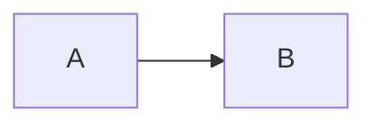
````

> + 输出以上代码块参照 [markdown中展示代码块](/软件/2023/10/08/markdown.html#代码块)
+ `mermaid` 中注释以 `%%` 开头独占一行

+ 运行结果


### 流程图
流程图由节点（几何形状）和边（箭头或线条）组成。Mermaid 代码定义了节点和边的生成方式，并支持不同类型的箭头、多方向箭头以及与子图的任意链接。

#### 单节点
````
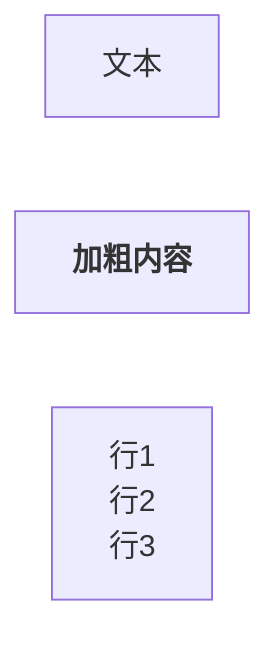
````


> + 使用  ``flowchart``/ ``graph`` 开头，紧跟着是流程图的布局方向。
+ "[文本]" 此内容为非必填，不填写就展示文本 ``id`` 。
+ 如果需要对节点文本使用 ``markdown`` 格式，需要使用  ``""``（双引号）将文本括起来，再使用 `` ` ``（反单引号）号将 ``markdown`` 格式内容括起来。


#### 多节点
````
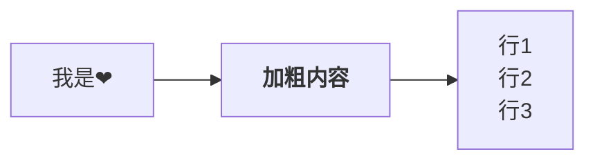
````


> + 各个节点之间的 ``id`` 通过使用 ``-->`` 进行节点连接线。
+ 布局方向
    + TB - 从上到下
    + TD - 自上而下 / 与从上到下相同
    + BT - 从底部到顶部
    + RL - 从右到左
    + LR - 从左到右


#### 节点形状
+ 基础节点形状
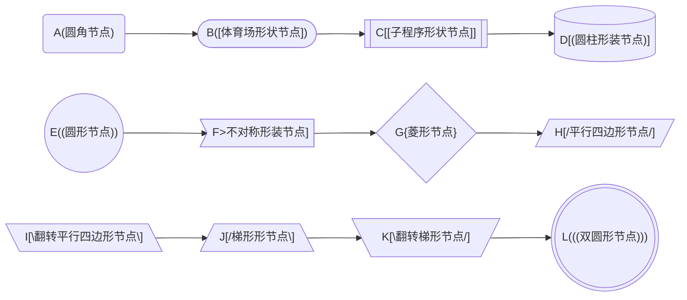


+ 新节点形状
需要 ``mermaid.js`` 版本 ``v11.3.0+`` 声明方式，e.g.  ``id@{ shape: 形装名称, label: "展示的文本" }`` 。
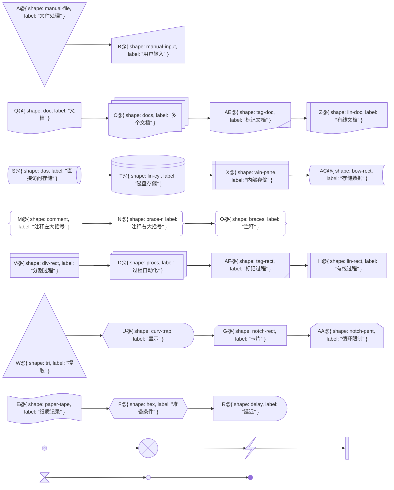


#### 连线
````
```mermaid
flowchart LR
// 实线 > 粗实线 > 箭头实线 > 箭头粗实线
A --- B === C --> D ==> E

// 长实线 > 长粗实线 > 长箭头实线 > 长箭头粗实线
AK ----- AL
AM ===== AN
AO ====> AP

// 文本实线 > 文本粗实线 > 文本箭头实线 > 文本箭头粗实线
F -- 文本 --- G == 文本 === H -- 文本 --> I == 文本 ==> J

// 虚线 > 箭头虚线
K -.- L -.-> M

// 文本虚线 > 文本箭头虚线
K -. 文本 .- L -. 文本 .-> M

// 箭头 > 圆形箭头 > x形箭头
Z --> AA --o AB --x AC

// 多方向箭头 > 多方向圆形箭头 > 多方向x形箭头
AD <--> AE o--o AF x--x AJ

// 无形连接（布局使用，强制使得 N O P 不折行）
N ~~~ O ~~~ P
N --> Q
P --> Q

// 多节点连线
R --> S & T --> U
V & W --> X & Y
```
````
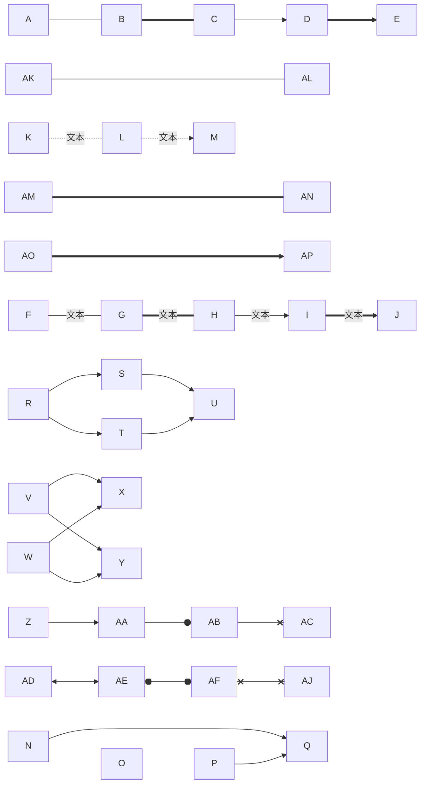


#### 子图
````
```mermaid
flowchart LR

  // 基础子图
  subgraph 开始
  A
  B
  C
  D
  end

  subgraph 处理
  E
  F
  end

  subgraph 结果
  G
  end

  A & B --> E
  C & D --> F
  E & F --> G

  // 子图、节点 互相连接
  subgraph 图1
  H
  end

  subgraph 图2
  I
  end

  subgraph 图3
  J
  end

  图1 --> 图2
  H --> 图2
  图2 --> J


  // 子图嵌套并设置顺序
  subgraph 外层
    direction TB
    subgraph 内层1
      K
    end

    subgraph 内层2
      direction RL
      L --> M
    end
  end

  内层1 --> 内层2
```
````
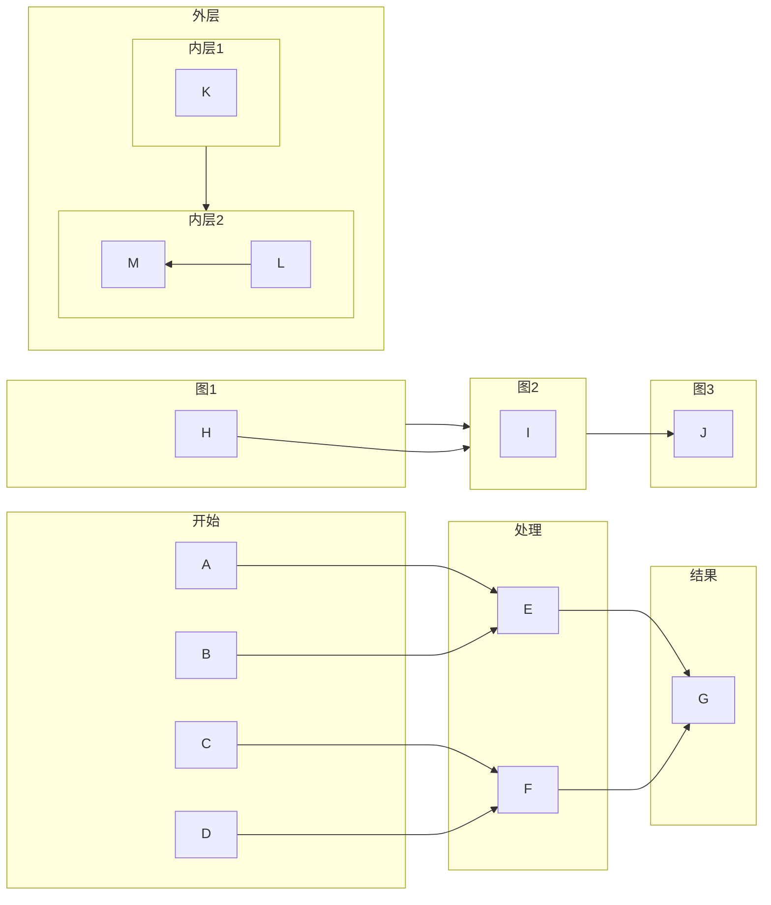

> + 如果子图的任何节点与外部链接，子图方向将被忽略。相反，子图将继承父图的方向。
+ 子图内部也可以设置节点连接方式


#### 交互
````
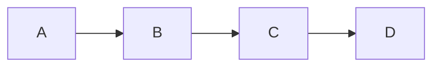
````

<script type="text/javascript">
  window.myClickHandle = function() {
    alert('自定义全局点击事件 myClickHandle');
  };
</script>

> + 支持点击事件需要 ` mermaid.initialize` 配置 `securityLevel: 'loose'` 。
+ 如果要配置 `target` 打开方式，需要在最后声明打开方式。


#### 样式
<style>
  .testCssRule rect {
    stroke: green !important;
    stroke-width: 6px !important;
  }
  .testCssRule .nodeLabel {
    color: #fff !important;
  }
</style>
````html
<!-- 定义样式表 -->
<style>
  .testCssRule rect {
    stroke: green !important;
    stroke-width: 6px !important;
  }
  .testCssRule .nodeLabel {
    color: #fff !important;
  }
</style>
````

````
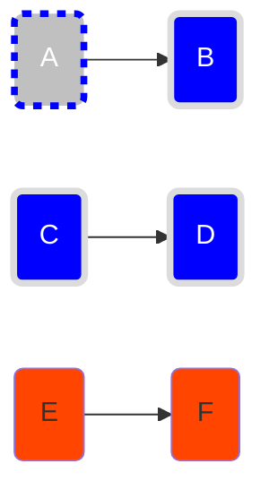
````


> + 通过 "class 节点 类名" 这种方式设置时，节点要放在前面。
样式表声明的方式，需要单独声明 `<style>` 样式表。
+ 所有节点都有一个默认类名 `default` ，如果要重写节点的默认样式 `classDef default fill:#f9f,stroke:#333,stroke-width:4px` ，默认类不需要显式映射到节点。


#### fontawesome字体
````
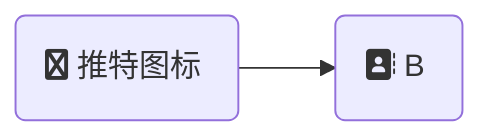
````


> + 通过引用 4.7.0 版本 `<link rel="stylesheet" href="https://cdn.jsdelivr.net/npm/font-awesome@4.7.0/css/font-awesome.min.css">`， `v4` 版本的 [图标查看](https://fontawesome.com.cn/v4/icons)。
+ 图标和文字混合会导宽度计算有误差，最后一个字符会被遮挡，可以给最后一个字符后面加一个 **空格** + **零宽空格**（`html` 实体写法 `&ZeroWidthSpace;`，流程图内文本的 `html` 实体写法只支持 "#" + 十进制写法） 把宽度拉长避免遮挡（如果末尾只写一个空格会被渲染时清空掉）。


## 时序图
### 时序图语法
````
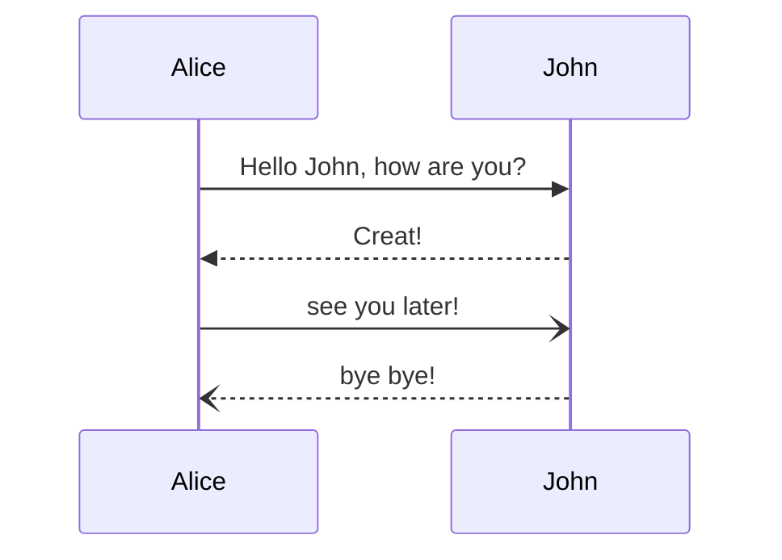
````


> + 关于节点的一个说明，单词“end”可能会破坏图表，这是由于 mermaid 语言的编写方式造成的。 如果不可避免，则必须使用括号()、引号""或方括号`{}、[]`将单词“end”括起来。例如：`(end)、[end]、{end}`。
+ `->>` 实现箭头， `-->>` 虚线箭头， `-)` 实线尖角箭头， `--)` 虚线尖角箭头。    


+ 参与者
上面的示例中 Alice、John 属于参与者，可以向上面那样隐式定义，也可以显式声明参与者，关键字 `participant + 参与者名称` 空格分隔。
````
```mermaid
sequenceDiagram
  participant Alice
  participant John

  Alice-->>John: 你好！
  John-->>Alice: 很好！
```
````
```mermaid
sequenceDiagram
  participant Alice
  participant John

  Alice-->>John: 你好！
  John-->>Alice: 很好！
```


+ 角色
如果您特别想使用角色符号而不是带有文本的矩形，则可以使用如下所示的 actor 语句。
````
```mermaid
sequenceDiagram
  actor Alice
  actor John

  Alice-->>John: 你好！
  John-->>Alice: 很好！
```
````
```mermaid
sequenceDiagram
  actor Alice
  actor John

  Alice-->>John: 你好！
  John-->>Alice: 很好！
```


+ 别名
角色可以有一个方便的标识符和一个描述性标签。
````
```mermaid
sequenceDiagram
  participant A as Alice
  participant J as John

  A->>J: Hello John, how are you?
  J->>A: Great!
```
````
```mermaid
sequenceDiagram
  participant A as Alice
  participant J as John

  A->>J: Hello John, how are you?
  J->>A: Great!
```


+ 角色创建和销毁（V10.3.0+）
````
```mermaid
sequenceDiagram
    Alice->>Bob: Hello Bob, how are you ?
    Bob->>Alice: Fine, thank you. And you?

    create participant Carl

    Alice->>Carl: Hi Carl!

    create actor D as Donald
    
    Carl->>D: Hi!

    destroy Carl

    Alice-xCarl: We are too many

    destroy Bob

    Bob->>Alice: I agree
```
````
```mermaid
sequenceDiagram
    Alice->>Bob: Hello Bob, how are you ?
    Bob->>Alice: Fine, thank you. And you?

    create participant Carl

    Alice->>Carl: Hi Carl!

    create actor D as Donald

    Carl->>D: Hi!

    destroy Carl

    Alice-xCarl: We are too many

    destroy Bob

    Bob->>Alice: I agree
```

> + `create` 和 `destory` 的渲染含义: 这是**UML 时序图对象生命周期语义**：普通 participant/actor 是在图表顶部一次性全部画出；`create` / `destroy` 用来表达**对象在交互过程中动态实例化、销毁**。
+ `create`
  + 渲染表现
    + Carl 不会在时序图最上方一开始就出现。
    + 在 `Alice->>Carl` 这条消息的位置，才把 Carl 的方框 + 生命线画出来。
    + 生命线从这条消息位置向下延伸，而不是从图表顶端开始。
  + 语义约束
    + `create` 只能创建**消息接收方**（不能创建发送方）。
    + 支持别名写法：`create actor D as Donald`（D 是标识符，显示名称 Donald）。
+ `destroy`
  + 渲染表现
    + 在紧随其后的这条消息（`Alice-xCarl`）处，**终止 Carl 的生命线**。
    + 在生命线末端画一个叉号，标记对象生命周期结束。
    + `destroy` 必须**紧跟一条消息**，否则会报语法错误。
  + 语义约束
    + destroy 可以销毁**消息发送方 或 接收方**（和 create 不一样）。
    + 箭头推荐用 `-x`（叉号箭头），UML 习惯代表销毁 / 删除消息。
    +**<font color=red>**即使 destroy 之后，仍然可以继续写消息**（Mermaid 不会阻止语法渲染），只是语义上代表：这条消息触发销毁动作。不是说销毁之后对象就彻底不能写消息了。</font>**


+ 分组/方框
角色可以分组到垂直方框中。您可以定义颜色（如果没有，则为透明）和/或使用以下表示法定义描述性标签。

````
```mermaid
sequenceDiagram
  box Purple Alice & John
  participant A
  participant J
  end
  box Another Group
  participant B
  participant C
  end
  A->>J: Hello John, how are you?
  J->>A: Great!
  A->>B: Hello Bob, how is Charley?
  B->>C: Hello Charley, how are you?
```

> + 语法为 `box + [transparent] + [颜色] + 描述` ，结束 `end`。
+ 颜色为可选参数，如果你的标题刚好是颜色名字，可以通过 transparent 让填充颜色透明，避免影响渲染效果。

````
```mermaid
sequenceDiagram
  box transparent orange Alice & John
  participant A
  participant J
  end
  box Another Group
  participant B
  participant C
  end
  A->>J: Hello John, how are you?
  J->>A: Great!
  A->>B: Hello Bob, how is Charley?
  B->>C: Hello Charley, how are you?
```


